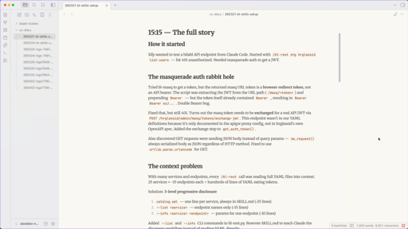
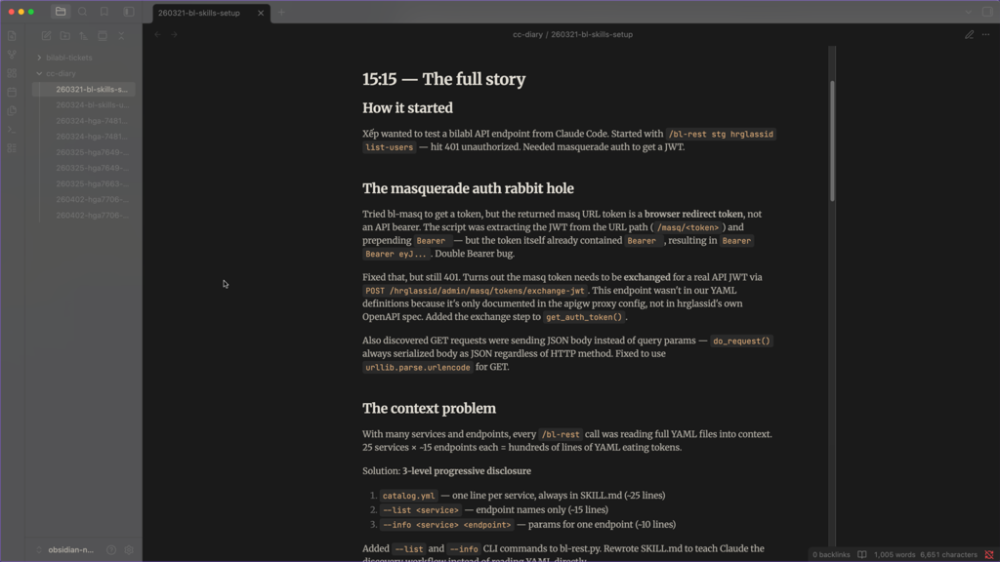

# Novel — An Obsidian Theme

> A warm, paper-like reading experience for writers, researchers, and thinkers.

**Install from the Obsidian theme store: [community.obsidian.md/themes/novel](https://community.obsidian.md/themes/novel)**


---

## Overview

**Novel** brings the timeless aesthetic of physical books into Obsidian. Inspired by the look and feel of printed pages, it uses warm parchment tones, refined serif typography, and generous whitespace to create an environment where reading and writing feel intentional — not digital.

Whether you're drafting long-form writing, building a personal knowledge base, or keeping a daily log, Novel gets out of your way and lets your words take center stage.

---

## Features

- 🎨 **Warm paper palette** — Soft parchment backgrounds (`#faf8f3`) with earthy accent tones
- 🌗 **Full dark mode** — Deep dark background with warm-tinted text, no harsh contrast
- 🔤 **Serif-first typography** — Merriweather for headings and body; JetBrains Mono for code
- 📐 **Comfortable reading width** — Max-width constrained layout, centered for focus
- 📝 **Styled callouts & blockquotes** — Warm left-border accent, subtle background tint
- 🗂️ **Clean tables** — Alternating row shading, no visual clutter
- ✅ **Task list support** — Native checkbox styling with accent color

---

## Screenshots

| Light Mode | Dark Mode |
|---|---|
|  |  |

---

## Installation

### Via Community Themes (Recommended)

Novel is listed in the Obsidian theme store: [open the Novel page](https://community.obsidian.md/themes/novel), or install it from inside Obsidian:

1. Open **Settings → Appearance → Themes**
2. Click **Manage**
3. Search for `Novel`
4. Click **Install and use**

### Manual

1. Download `theme.css` from the [latest release](../../releases/latest)
2. Copy it to your vault's `.obsidian/themes/Novel/` folder
3. Open **Settings → Appearance → Themes** and select **Novel**

---

## Fonts

The Novel theme strictly respects your privacy and works completely offline. 

The custom fonts used in this theme are optimally encoded in Base64 and natively bundled into the theme file. You do not need an internet connection or extra installations to use them!

- **Body/Headings:** Merriweather (embedded), gracefully falls back to Georgia (serif)
- **Code:** JetBrains Mono (embedded), gracefully falls back to Fira Code → monospace

---

## Compatibility

| Platform | Supported |
|---|---|
| Obsidian Desktop (macOS, Windows, Linux) | ✅ |
| Obsidian Mobile (iOS, Android) | ✅ |
| Obsidian Publish | 🚧 Planned |

Minimum Obsidian version: **1.0.0**

---

## Customization

Novel pairs well with CSS snippets for further tweaking. To add your own:

1. Create a `.css` file in `.obsidian/snippets/`
2. Enable it under **Settings → Appearance → CSS snippets**

**Example: Wider reading width**
```css
.markdown-preview-view {
  max-width: 1100px;
}
```

**Example: Change accent color**
```css
.theme-light {
  --accent: #2d6a4f;
}
```

---

## Color Reference

### Light Mode

| Variable | Value | Usage |
|---|---|---|
| `--bg-primary` | `#faf8f3` | Main background |
| `--bg-secondary` | `#f5f2eb` | Sidebar, table rows |
| `--text-primary` | `#5a5a5a` | Body text |
| `--text-heading` | `#3a3a3a` | Headings |
| `--accent` | `#8b4513` | Links, inline code, borders |

### Dark Mode

| Variable | Value | Usage |
|---|---|---|
| `--bg-primary` | `#1a1a1a` | Main background |
| `--bg-secondary` | `#252525` | Sidebar, table rows |
| `--text-primary` | `#b0aca3` | Body text |
| `--text-heading` | `#e0dcd3` | Headings |
| `--accent` | `#d4a574` | Links, inline code, borders |

---

## Changelog

### 1.0.0 — Initial Release
- Light and dark mode
- Merriweather + JetBrains Mono typography
- Styled headings, blockquotes, tables, code blocks, task lists

---

## License

[MIT License](LICENSE)

---

## Feedback & Issues

Found a bug or have a suggestion? Open an issue on [GitHub](../../issues).
